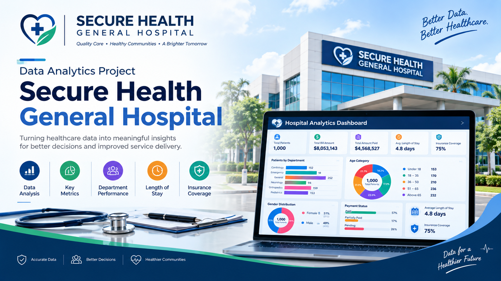
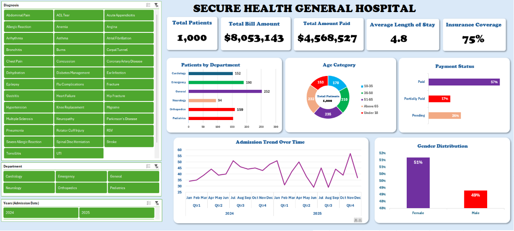

# Secure-Health-General Hospital Performance Dashboard - Data Analytics
## INTRODUCTION

This is a healthcare organizations generate data that can help them understand patient demographics, hospital department performance, billing, insurance coverage, and payment status. However, this data becomes more useful when it is properly organized, analyzed, and presented in a clear visual format.
This is my first project as a data analytics scholar of Fadaqa 2026 cohort, this project focuses on analyzing hospital data for Secure Health General Hospital using Microsoft Excel. The goal is to transform raw data into meaningful insights through data analysis, PivotTables, charts, and interactive slicers to support better understanding and decision-making.

## ABOUT THE DATASET
The dataset contains hospital-related information covering patient records, diagnoses, departments, admission dates, age categories, gender, billing amounts, payment status, length of stay, and insurance coverage.
The dashboard summarizes **1,000 patient records** and presents key indicators and visualizations that provide an overview of the hospital's patient population and financial information.
The analysis was carried out using Microsoft Excel, with PivotTables, charts, and slicers used to summarize and explore the data.

## PROBLEM STATEMENT
PROBLEM STATEMENT
Hospital data can be difficult to interpret when it is stored in large tables without clear summaries or visual representations.
This project addresses the need to organize and analyze hospital data to answer important questions:
-	How many patient records are included in the dataset?
-	Which hospital departments have the highest and lowest patient counts?
-	How are patients distributed across age categories and gender?
-	What proportions of payments are paid, partially paid, or pending?
-	What are the total billing amount, total amount paid, and insurance coverage?
-	How does the admission trend change over time?
The objective is to use Excel to present these findings in a clear, interactive dashboard.

## VISUALIZATION

The dashboard was developed in Microsoft Excel to provide a visual summary of the hospital data.
It includes:
-	KPI cards showing total patients, total bill amount, total amount paid, average length of stay, and insurance coverage.
-	A bar chart showing patient distribution by department.
-	A doughnut chart showing patient distribution by age category.
-	A horizontal bar chart presenting payment status.
-	A line chart displaying admission trends across 2024 and 2025.
-	A gender distribution chart.
-	Interactive slicers for diagnosis, department, and admission year.
These visualizations make it easier to explore the dataset and identify patterns across different categories.

## INSIGHTS
The dashboard reveals the following key findings:
-	**Patient records:** The dataset contains 1,000 patient records.
-	**Department distribution:** The General department has the highest patient count, with 252 records. Neurology has the lowest count, with 94 records.
-	**Age distribution:** The 51–65 age category contains 235 patients, while the Under 18 category contains 153 patients. The 51–65 group is the largest age category shown.
-	**Gender distribution:** Female patients account for 51% of the records, while male patients account for 49%, indicating a nearly balanced distribution.
-	**Payment status:** The dashboard reports 57% as Paid, 17% as Partially Paid, and 26% as Pending. Pending payments represent a notable share of the displayed payment-status distribution.
-	**Financial overview:** The total bill amount is $8,053,143, while the total amount paid is $4,568,527.
-	**Insurance coverage:** The dashboard reports insurance coverage of 75%.
-	**Average length of stay:** The displayed average length of stay is 4.8.
-	**Admission trends:** The admission trend chart displays changes in admission counts across 2024 and 2025, allowing users to explore variations over time.

## RECOMMENDATIONS

Based on the findings displayed in the dashboard, the following actions are recommended:
-	Monitor pending payments: Investigate outstanding balances and strengthen payment follow-up procedures.
-	Review department workload: Examine patient volumes across departments to support appropriate staffing and resource planning.
-	Track admission patterns: Monitor monthly admission trends to help anticipate changes in demand.
-	Review insurance records: Validate insurance information and monitor coverage to improve the completeness of financial reporting.
-	Maintain data quality: Check for missing values, duplicate records, inconsistent categories, and incorrect entries.
-	Use regular reporting: Refresh the dashboard periodically to keep hospital performance summaries up to date.
These recommendations should be validated against detailed operational data before implementation.

## CONCLUSION
This project demonstrates how Microsoft Excel can be used to transform hospital data into an interactive and informative dashboard. Through data summarization, PivotTables, charts, and slicers, the analysis presents an overview of patient demographics, department distribution, payment status, billing, insurance coverage, and admission trends.
The project strengthened my practical skills in Excel-based data analysis, data visualization, and communicating findings through dashboards.
It also reinforced the importance of data quality and clear reporting in supporting evidence-based decision-making.

**Project:** Secure Health General Hospital — Data Analytics Project
**Tool:&** Microsoft Excel
**Focus Areas:** Data Analysis, PivotTables, Data Visualization, Interactive Dashboards

